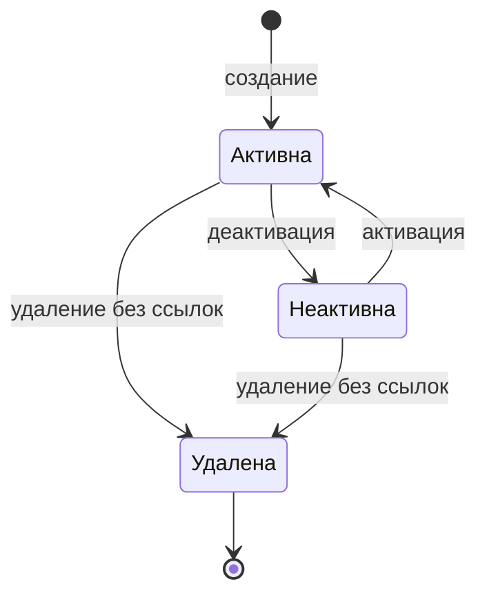

## BG-COUNTRY-001 {#bg-country-001}
- **Наименование**: Электронный обмен накладными между субъектами хозяйствования.
- **Использует**: [BG-001][1]
- **Используется в**: SF-COUNTRY-LIST, SF-COUNTRY-READ, [SF-COUNTRY-CREATE][2], SF-COUNTRY-UPDATE, 
SF-COUNTRY-ACTIVATION, SF-COUNTRY-DELETE, SF-COUNTRY-IMPORT.  
- **Описание**: Единый, достоверный и управляемый справочник стран, на который опираются адреса, контрагенты и документы 
всех подсистем. Тогда данные о странах не расходятся и не дублируются.

## BR-COUNTRY-001 {#br-country-001}

Заинтересованные стороны {#stakeholders}

Стороны, интересы которых затрагивает справочник:

- **Владелец справочников**: Корректность и актуальность перечня стран.
- **Администраторы данных**: Быстрое внесение изменений без обращения к разработчикам.
- **Разработчики других подсистем**: Стабильные коды и контракт для выбора страны.
- **Аудит и безопасность**: Прослеживаемость изменений: кто, когда и что изменил.

## Словарь {#glossary}

Термины, которые одинаково понимают бизнес, аналитики, разработчики и тестировщики:

- **Страна**: Запись справочника о государстве или территории с кодами ISO 3166-1 и названиями.
- **Код alpha-2, alpha-3, numeric**: Двухбуквенный, трёхбуквенный и трёхзначный числовой коды страны по ISO 3166-1.
- **Активная страна**: Страна, доступная для выбора в других подсистемах и видимая всем ролям.
- **Неактивная страна**: Страна, скрытая от выбора и от читателя, но сохранённая вместе со ссылками на неё.
- **Ссылка на страну**: Использование страны в данных другой подсистемы: в адресе, у контрагента или в документе.
- **Версия записи**: Номер, который растёт при каждом изменении записи и защищает от потери чужих правок.
- **ЕРК**: Единый реестр классификаторов, внешняя система, источник перечня стран для импорта (EI-COUNTRY-001).
- **Импорт стран**: Получение набора стран из ЕРК, сравнение со справочником и применение различий после подтверждения администратором.
- **Задание импорта**: Запись о запуске импорта с версией набора ЕРК, статусом и отчётом по каждой стране.
- **Запись аудита**: Неизменяемая запись о действии над страной: кто, когда, что сделал и что было до и после.

## Модель данных {#domain-model}

Справочник хранит одну сущность - **Страна**. Её атрибуты на языке бизнеса:

- **Идентификатор**: Уникальный и неизменный номер записи, который назначает система и не переиспользует.
- **Коды alpha-2, alpha-3 и numeric**: Обязательные, уникальные, задаются при создании и далее не меняются.
- **Название на русском**: Обязательное, уникальное без учёта регистра, от 1 до 100 символов, меняется.
- **Название на английском**: Обязательное, от 1 до 100 символов, меняется.
- **Признак активности**: Показывает, видна ли страна читателям. После создания страна активна.
- **Даты создания и изменения**: Назначает система, не редактируются пользователем.
- **Версия записи**: Начинается с 1 и растёт на 1 при каждом изменении.

Пример записи: Россия, коды `RU`, `RUS`, `643`, русское название "Россия", английское "Russia", активна, версия 1.

## Жизненный цикл страны {#lifecycle}

Страна проходит состояния "Активна", "Неактивна" и "Удалена". Все переходы, которых нет в списке ниже, запрещены:

