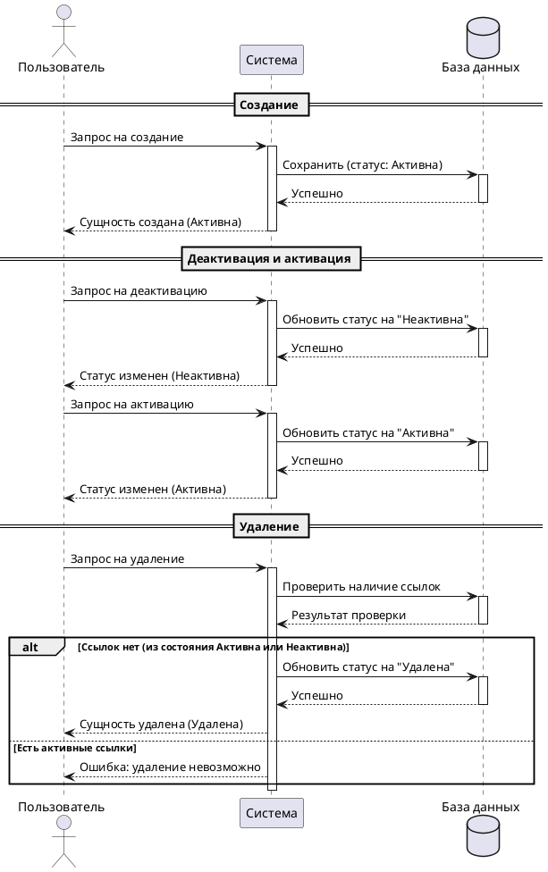
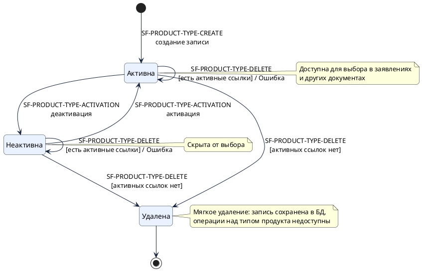

> Статус: анализ  
> Ответственный: Khilko Dmitry  
> Версия: 0.02.02 (09.11.2026 14:02)  
> Задача: [123][]  
> Релиз:  
> Дата релиза:   

# ОСНОВНАЯ ФУНКЦИОНАЛЬНОСТЬ {#f}

## Журнал изменений {#change-history .collapsed}

- Записей пока нет.

## F-PRODUCT-TYPE {#f-product-type}

- **Название**: Справочник видов изделий
- **Приоритет**: must
- **Использует**: [BG-001][]
- **Используется в**: [SF-PRODUCT-TYPE-LIST][], [SF-PRODUCT-TYPE-READ][], [SF-PRODUCT-TYPE-CREATE][], 
[SF-PRODUCT-TYPE-UPDATE][], [SF-PRODUCT-TYPE-ACTIVATION][], [SF-PRODUCT-TYPE-DELETE][]    
- **Описание**: Справочник видов изделий является единым, достоверным и управляемым источником данных для документов 
всех подсистем, что исключает расхождение и дублирование информации. Справочник обеспечивает единый перечень ювелирных 
изделий для сквозного учёта на всех этапах жизненного цикла работ: от формирования заявления до оформления выдачи. Для 
поддержания его актуальности пользователь может управлять записями вручную: просматривать, искать, создавать, 
редактировать, изменять статус и удалять.
- **Границы**:
    - **Входит**: Просмотр, поиск, создание, изменение, деактивация и удаление записей, права доступа и аудит изменений.
    - **Не входит**: Загрузка из файла, загрузка из внешних классификаторов, импорт из НСИ АСФР.

### Диаграмма последовательности {#sequence-diagram .collapsed}

Ниже представлена UML-диаграмма последовательности (Sequence Diagram), описывающая жизненный цикл сущности через 
взаимодействие пользователя, системы и базы данных.

### Диаграмма состояний {#f-product-type-state-diagram .collapsed}

Схема показывает, в каком статусе находится запись справочника и какая детальная функциональность переводит её из 
статуса в статус. Просмотр и поиск (`SF-PRODUCT-TYPE-LIST`, `SF-PRODUCT-TYPE-READ`) и редактирование 
(`SF-PRODUCT-TYPE-UPDATE`) статус записи не меняют.

Допущение, которое требует подтверждения: удаление доступно из обоих статусов, а условия удаления задаются в 
`SF-PRODUCT-TYPE-DELETE`.

[BG-001]: <../../../business-context/business-requirements.md#bg-001>
[SF-PRODUCT-TYPE-LIST]: <../sf-list/index.md#sf-country-list>
[SF-PRODUCT-TYPE-READ]: <../sf-list/index.md#sf-country-list>
[SF-PRODUCT-TYPE-CREATE]: <../sf-create/index.md#sf-country-create>
[SF-PRODUCT-TYPE-UPDATE]: <../sf-create/index.md#sf-country-create>
[SF-PRODUCT-TYPE-ACTIVATION]: <../sf-create/index.md#sf-country-create>
[SF-PRODUCT-TYPE-DELETE]: <../sf-create/index.md#sf-country-create>
[glossary]: <../../../business-context/glossary.md>
[123]: <../../../business-context/glossary.md>
